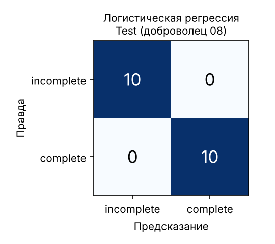
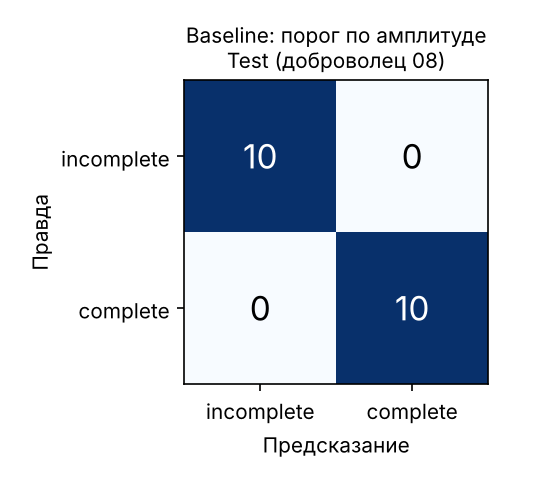

# SerIQ — отчёт с метриками

Задача: классификация цикла упражнения E02 (разгибание локтя) как complete / incomplete.
Данные: [An upper limb stroke rehabilitation exercise video dataset](https://data.mendeley.com/datasets/49h9dcwx5v/1), папка `2_Extending the Elbow`.
Train: 107 видео, добровольцы 01, 02, 03, 04, 05. Test: 20 видео, доброволец 08.
Метка берётся из папки (Complete/Incomplete). В `Complete/Train` 10 файлов `04_02_00_*` имеют «00» в имени — проверено по кадрам, это complete.

## Как оценивали
- Разбиение строго по ID добровольца: видео одного человека никогда не попадает и в обучение, и в проверку.
- Validation: Leave-One-Subject-Out на 01–05 (5 фолдов). Модель выбирали только по этой оценке.
- Test: доброволец 08 (другая камера и комната), посчитан один раз в конце.
- Признаки (5): rom, t_peak, v_mean, hold, frac45. Конечное положение руки намеренно не используем.

## Результаты

| Модель | LOSO balanced acc. (± разброс по людям) | LOSO F1 | Test balanced acc. | Test F1 | Test macro-F1 |
|---|---|---|---|---|---|
| Majority (всегда частый класс) | 0.50 ± 0.00 | 0.00 | 0.50 | 0.00 | 0.33 |
| Baseline: порог по амплитуде | 1.00 ± 0.00 | 1.00 | 1.00 | 1.00 | 1.00 |
| Логистическая регрессия **(выбрана)** | 1.00 ± 0.00 | 1.00 | 1.00 | 1.00 | 1.00 |
| Случайный лес | 1.00 ± 0.00 | 1.00 | 1.00 | 1.00 | 1.00 |

Порог baseline (на всём train): ROM > 46.7°.

### Матрица ошибок — Логистическая регрессия, test (08)
| | предск. incomplete | предск. complete |
|---|---|---|
| **правда incomplete** | 10 | 0 |
| **правда complete** | 0 | 10 |

### Матрица ошибок — baseline, test (08)
| | предск. incomplete | предск. complete |
|---|---|---|
| **правда incomplete** | 10 | 0 |
| **правда complete** | 0 | 10 |

## Почему метрики почти 100% — и где это может сломаться
Амплитуда движения (ROM) по классам, градусы:

| Выборка | Класс | min | медиана | max |
|---|---|---|---|---|
| test | incomplete | 15 | 18 | 28 |
| test | complete | 69 | 80 | 83 |
| train | incomplete | 14 | 27 | 40 |
| train | complete | 53 | 77 | 106 |

Между классами зазор: неполные движения не больше 40°, полные — не меньше 53°. Поэтому на этом датасете задача почти линейно разделима, и даже простой порог работает. Наша модель добавляет оценку уверенности и учитывает скорость, удержание и плавность — это важно для живой камеры, где ракурс, свет и выделение циклов хуже, чем в аккуратно снятых роликах.

Где может сломаться: другой ракурс камеры (сверху, а не сбоку), люди с компенсаторными движениями, очень медленные или дрожащие движения, неточное выделение циклов в непрерывном видео.

## Стресс-тест: другая камера и дрожание
Каждое из 127 видео прогнали с частотой 24, 30 и 60 кадров/с и случайным дрожанием угла 1,5–3° (так ведёт себя браузерная камера). Ошибок: 0 из 508. Для этого ряд угла всегда приводится к 15 точкам в секунду, а признаки, зависящие от частоты кадров (число смен направления, пиковая скорость), в модель не входят — мы нашли эту проблему при живом тесте.

## Защита от слишком быстрого движения
В train почти все полные движения (98%) опускают руку не быстрее чем за 2.4 c (медиана 5.6 c). Быстрее модель движений не видела, поэтому, если рука опустилась быстрее 1.9 c, приложение отвечает «Проверьте инструкцию» («движение быстрее, чем в инструкции»), а не угадывает. Это правило, а не часть модели; найдено при живом тесте.

## Уверенность
p(complete) ≥ 0.7 → «Выполнено». Иначе → «Проверьте инструкцию»; при 0.3 < p < 0.7 или плохой видимости руки — дополнительно «результат неточный, повторите».
На LOSO в «неуверенную» зону попало 0% циклов.

## Ограничения (честно)
- В test один человек и 20 видео: одна ошибка меняет balanced accuracy примерно на 10 п.п.
- Судя по описанию датасета, сняты добровольцы, а не пациенты; у пациентов возможны компенсаторные движения.
- В датасете одно видео = один цикл; в приложении циклы выделяются автоматически из непрерывного видео.
- Прототип не является медицинским изделием и не даёт медицинских рекомендаций.